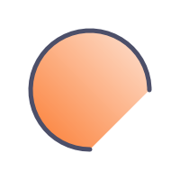

# Exemples AGGPas

Dessin avec l'unité *agg_2D.pas*. Création d'une image PNG avec la bibliothèque *fcl-image*.



## Où trouver AGGPas

AGGPas fait partie de fpGUI et de Lazarus.

### fpGUI

```
git clone https://github.com/graemeg/fpGUI.git
```

Les unités, y compris *agg_2D*, se trouvent dans le dossier [framework/src/main/pascal/corelib/render/software](https://github.com/graemeg/fpGUI/tree/develop/framework/src/main/pascal/corelib/render/software).

### Lazarus

```
git clone https://gitlab.com/freepascal.org/lazarus/lazarus.git
```

Les unités se trouvent dans le dossier [components/aggpas/src](https://gitlab.com/freepascal.org/lazarus/lazarus/-/tree/main/components/aggpas/src?ref_type=heads).

## Comment compiler les exemples

Compiler un exemple :
```
make arc
```

Compiler tous les exemples :
```
make
```

Compiler tous les exemples en utilisant la LCL :
```
make LCL=1
```

Vous devrez modifier dans *Makefile* le chemin vers les unités AGGPas.

## Autres exemples

| Dossier | Description |
| --- | --- |
| [fpgui/fpgclock](fpgui/fpgclock) | Horloge simple dans une fenêtre fpGUI |
| [fpgui/fpgclock2](fpgui/fpgclock2) | Horloge dans une fenêtre fpGUI, avec un cadran pré-rendu dans une image PNG |
| [fpgui/fpgform](fpgui/fpgform) | Dessin dans une fiche fpGUI |
| [mathlib](mathlib) | Exemples utilisant la bibliothèque [mathlib-fp](https://github.com/ikelaiah/mathlib-fp) |
| [msegui/tbitmap](msegui/tbitmap) | MSEgui, sans fenêtre : dessin dans une image enregistrée au format PNG |
| [msegui/tbitmap-2](msegui/tbitmap-2) | Idem, AGGPas attaché directement à l'image |
| [msegui/tpaintbox-tbitmap](msegui/tpaintbox-tbitmap) | MSEgui : dessin dans une zone de dessin (tpaintbox) |
| [msegui/tpaintbox-tbitmap-2](msegui/tpaintbox-tbitmap-2) | Idem, AGGPas attaché directement à l'image |
| [ptc](ptc) | Animation dans une console PTCPas |

## Crédits

L'unité *AggExample* est dérivée du programme [Agg2DConsole.dpr](https://github.com/graemeg/fpGUI/blob/develop/extras/aggpas/agg-demos/Agg2DConsole.dpr).

Les exemples utilisent la police [Nougat](https://www.dafont.com/fr/nougat.font) de Dieter Steffmann.

## Voir aussi

- [Chess Image 2](https://github.com/rchastain2/chess-image-2)
