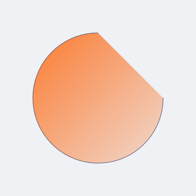

# MSEgui + AGGPas demo

Windowless program: drawing with AGGPas in a tmaskedbitmap and saving the result to a PNG file.

AGGPas is attached directly to the bitmap memory (`scanline[0]`, `scanlinestep`): no intermediate buffer, no copy.

Build with `make`, run with `./demo` to create `output.png`.

