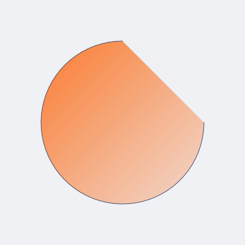

# MSEgui + AGGPas demo

Windowless program: drawing with AGGPas in a tmaskedbitmap and saving the result to a PNG file.

AGGPas draws into an intermediate memory buffer, which is then copied line by line into the bitmap.

Build with `make`, run with `./demo` to create `output.png`.

